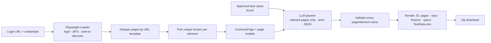

# 🎭 AI Automation Code Generator

Turn approved manual test cases into a ready-to-run **Playwright (JavaScript) Page Object Model** project.
The app logs in to your web application, visits every unique page, records each page's elements with
reliable locators, then maps every test step onto those elements. You download a zip, open it in
IntelliJ / WebStorm / VS Code, `npm install`, and run.

Pairs with the [AI Test Case Generator](https://github.com/samramkumarqa/GenerativeAI): its approved
Excel test pack is this app's input.

Python · Playwright · Groq (GPT-OSS 120B) · Streamlit

---

## What it does

1. **Load test cases**: the Excel exported by the AI Test Case Generator (or any sheet with
   *Test Case ID*, *Title* and *Steps* columns). A Swag Labs sample is built in.
2. **Crawl the application**: a real Chromium browser logs in (the login form is detected
   automatically), follows links *and* link-like buttons so single-page apps work too, and records
   every interactive element on each page.
   - Pages are de-duplicated by URL template: `/item/4` and `/item/5` are one `ItemDetailPage`.
   - Elements shared by most pages (header, menu, cart link) go into a `CommonPage` that every
     page object extends.
   - Locators prefer test IDs (`data-testid`, `data-test`, ...), then stable ids, role + accessible
     name, label, placeholder, text. Each one is checked to match **exactly one** element.
   - The crawl is read-only: it never clicks Logout, Delete, Pay, Reset and similar, and never
     submits forms other than the login.
3. **Generate the project**: the model maps each manual step to `{page, element, action, data}`.
   The app checks every name against the crawl and renders the JavaScript itself, so generated code
   only uses locators that exist and is always valid. Steps that can't be mapped become `// TODO`
   comments and are listed in the app and the generated README.

## The generated project

```
playwright-pom-<site>/
├── package.json                 npm test · test:headed · test:ui · report
├── playwright.config.js         baseURL + testIdAttribute from the crawl, traces/screenshots on failure
├── .env.example                 BASE_URL, APP_USERNAME, APP_PASSWORD
├── pages/
│   ├── BasePage.js              resolves locators from the object repository
│   ├── CommonPage.js            shared header/menu elements (all pages extend it)
│   ├── LoginPage.js             + login(username, password)
│   └── InventoryPage.js ...     one class per crawled page, a getter per element
├── object-repository/*.json     locators per page: fix a broken locator here, not in code
├── fixtures/pages.js            page objects as Playwright fixtures
├── test-data/TestData.xlsx      input sheet: RunControl (Run Y/N) + TestData (key/value per test)
├── utils/testData.js            reads the input sheet
└── tests/FR-01.spec.js ...      one spec per requirement, one test per test case
```

Example generated test:

```js
test("TC-004: Verify checkout requires the first name", async ({ cartPage, checkoutStepOnePage, commonPage, inventoryPage, loginPage, page }) => {
  test.skip(!(await shouldRun("TC-004")), 'Run = N in test-data/TestData.xlsx');
  const data = await getTestData("TC-004");
  await loginPage.login();
  await inventoryPage.addToCartBackpackButton.click();
  await commonPage.shoppingCartLink.click();
  await cartPage.checkoutButton.click();
  await checkoutStepOnePage.lastNameInput.fill(data.lastName);
  await checkoutStepOnePage.postalCodeInput.fill(data.postalCode);
  await checkoutStepOnePage.continueButton.click();
  await expect(checkoutStepOnePage.errorText).toContainText(data.expectedError);
});
```

## How it works



## Local mode vs public demo

Crawling needs a browser and the target site's login, so:

- **Public demo (Streamlit Cloud)** only crawls practice sites with published test logins
  (Swag Labs, The Internet).
- **Local** (your machine): set `ALLOW_ANY_SITE=true` in `.env` and crawl your own application.
  Credentials are used only for the crawl and are never written into the generated project
  (it reads `APP_USERNAME` / `APP_PASSWORD` from its own `.env`).

## Run locally

```bash
python3 -m venv .venv && source .venv/bin/activate
pip install -r requirements.txt
playwright install chromium
cp .env.example .env          # add your Groq key from https://console.groq.com/keys
streamlit run main.py
```

## Tests

```bash
pip install -r requirements-dev.txt
pytest
```

The suite crawls a small local practice shop (`tests/site`, a single-page-style app with login,
JS navigation, and Logout/Reset links that must never be clicked), validates plans, checks every
generated `.js` file with `node --check`, and **npm-installs the generated project and runs it with
Playwright**, expecting 5 passed and 1 skipped (via the Run = N switch in the input sheet).
A fake model stands in for Groq, so tests need no API key.

## Limitations

- Pages that only appear after submitting a form (e.g. an order confirmation) aren't reached;
  the crawler never submits forms beyond the login.
- Logins with MFA, CAPTCHA or SSO redirects aren't supported.
- Repeated elements without unique attributes (e.g. many identical "Edit" buttons) are skipped
  rather than given a fragile locator.
- Always review the generated tests; `// TODO` lines mark steps that need a human.
